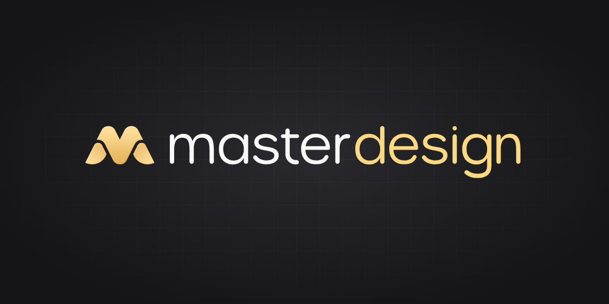

# Master Design

Practical guidelines for clear, adaptable and carefully made web interfaces, with a portable Agent Skill and a public guide at [design.master.co](https://design.master.co).

Master Design owns principles, foundations, accessibility, component usage, task patterns and verification methods. [Master UI](https://ui.master.co) implements reusable components, themes and behaviors; [Master CSS](https://css.master.co) provides the styling engine; [Master](https://master.co) owns the ecosystem website and shared site infrastructure.

Use one entry, **`$master-design`**. It follows the consumer project's framework, brand, fonts and density, then loads the relevant guidance. General guidance remains self-contained and independent of any component library. Master UI-specific material and implementation decisions live in [Master UI’s design foundations](https://ui.master.co/guide/design).

The website and installed skill share the Markdown in `skills/master-design/references/`. The site adapts that source for navigation, links and search; it maintains no second copy of the prose or runtime tokens. Existing craft studies remain local research examples.

The website adds explanatory figures, interactive studies and complete local task examples. Their code and the internal documentation-illustration skill belong to this repository's authoring workflow; they are not installed with the public skill. The reference text remains useful without the site.

## Install

```sh
npx skills add master-co/design --skill master-design
```

That follows `main`. To pin a [release](https://github.com/master-co/design/releases), install its tag:

```sh
npx skills add https://github.com/master-co/design/tree/v0.2.0 --skill master-design
```

Each release also attaches the skill folder as a zip with its SHA-256 checksum. The [changelog](CHANGELOG.md) lists what each version changes.

For the current local checkout:

```sh
npx skills add ./ --skill master-design
```

Choose the target project and agent through the installer. The installed skill is self-contained; the example app, Bun, Node, browser tools and companion article are not installation requirements.

## Use

```text
Use $master-design to refine this interface while preserving its brand,
fonts and compact density. Implement and verify the affected states.
```

```text
Use $master-design for this new workspace. I want quiet near-white
surfaces, clear text and stable control feedback.
```

```text
Use $master-design to review these controls. Explain concrete findings
and verification limits without modifying the project.
```

The skill covers principles, accessibility, visual foundations, component choices, task flows and detailed interface craft. It distinguishes measured results, derived geometry and visual judgment. Missing browser access is reported rather than replaced with a claim of pixel verification.

## Companion study

[Interface craft](docs/article-map.md) connects every topic to 35 baseline diagrams, four avatar studies, six typography/layout studies and two interaction studies. The five-language [companion article](https://aron.tw/blog/interface-craft) explains the mechanisms with original illustrations. Its complete history and original illustrations remain in the article repository.

The standalone [workspace example](examples/interface-craft/README.md) reuses its coherent illustrative data and desktop geometry, with real project search, filtering, selection and responsive navigation. It contains no backend. The [avatar-stack study](examples/interface-craft/avatar/README.md) adds four original single-variable diagrams and a photo/initials participant example; the article includes these four studies alongside its 35 baseline diagrams.

The [type and row study](examples/interface-craft/typography-layout/README.md) adds five-language samples, real controls and six shared CJK/row diagrams. Its reading-controls section applies the aron.tw integration findings to heading targets, wrapping result arrows and touch-visible copy. It preserves the existing workspace.

## Website

The English-first Astro and Svelte guide uses `@master/internal-site` for its shared shell and `@master/ui` for reusable presentation. It builds a static Cloudflare Pages artifact; no account, backend or runtime content fetch is required.

```sh
bun install --frozen-lockfile
bun run dev
bun run build:site
bun run check:site
bun run test:site
bun run test:site-dev
```

`bun run dev` starts a foreground development server at `http://127.0.0.1:3400` (or the next available port). Keep the terminal running; Ctrl+C stops it. Pass `--port 3407` or `--host 127.0.0.1` to override its address. Changes to canonical Markdown, the page catalog and figure registration automatically regenerate the adapters, search and downloads. Astro handles component and stylesheet updates. Preparation errors are reported in the terminal; fix the source and save again to recover. `test:site-dev` checks cold startup and live updates in an isolated copy under ignored artifacts.

Edit the skill Markdown, not generated `site/content`. `site/scripts/prepare.ts` builds routes, categories, search and downloadable Markdown from the source catalog. The separate `deploy-site.yml` workflow reuses the full checks on every push to `main`, rebuilds the commit, requires the exact tested bytes and publishes a manifest of every output file. It then moves the `pages-stable` branch, which Cloudflare Pages builds with its Git integration and deploys only when the output matches that manifest byte for byte. GitHub holds no Cloudflare credential; until the Pages repository variables exist, nothing is delivered. Project and domain configuration remain separate authorized operations. See [website deployment](docs/site-deployment.md).

## Develop

Use Bun 1.4.4 and Node 24.20.0 for repository tooling:

```sh
bun install --frozen-lockfile
bun run build
bun run demo
```

The demo server prints its local URL. In a second terminal:

```sh
bun run check
bun run test:install
bun run test:avatars
bun run test:dashboard
bun run test:browser
bun run test:native
bun run test:forward
bun run capture
bun run capture:avatars
bun run test:typography
bun run test:reading
bun run capture:typography
```

Install the Playwright Chromium and WebKit binaries before browser checks if needed. Exports, hashes and screenshots are written to ignored `artifacts/`. See [verification](docs/verification.md) for methods and actual results.

## Contribute

Read the [contribution guide](CONTRIBUTING.md) for scope, evidence and checks. Use the [issue forms](https://github.com/master-co/design/issues/new/choose) for a reproducible problem, craft proposal or documentation question; focused fixes can go straight to a pull request. See the [changelog](CHANGELOG.md) for the current version.

## License and sources

The portable skill, its reference Markdown and the reusable example source are [MIT licensed](skills/master-design/LICENSE.txt). The original website implementation, site-only content and Master brand assets are reserved to Aoyue Design LLC. See the [repository license notice](LICENSE) for the full scope and [sources](docs/sources.md) for the provenance of the examples.
