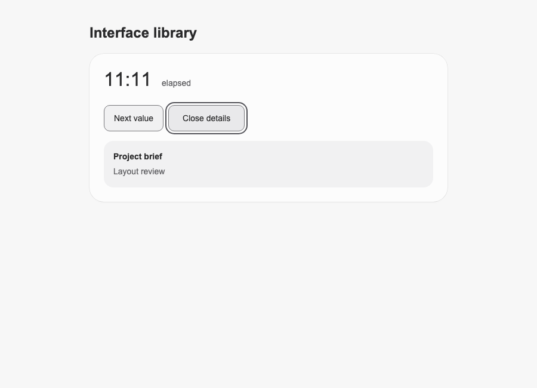
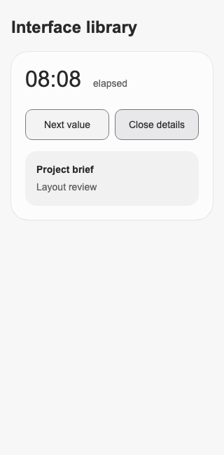

# Library controls refinement

Implemented in `work/index.html` using the frozen Master Design skill v0.1.0 and its explicitly requested Aron preferences. The original title, labels, details text, initial elapsed value, three-value cycle, local disclosure behavior and Arial font remain. `before/` was left untouched; its [SHA-256](before.sha256) is recorded. No dependencies were installed and nothing was committed or published.

## Changes and reasoning

- **Quieter surface hierarchy.** Applied the Aron near-white canvas `#f7f7f7`, content `#fcfcfc`, and neutral inset `#f1f1f2`. The card has a 24px radius, a single outside .5px/12% dark contour and short 4%/2% shadow layers. Removed the hard inner white highlight and broad drop shadow. The details surface uses a 16px radius. These are deliberately tuned specimen values, not a claim that every control needs the same contour.
- **Stable typography.** Kept Arial, clarified heading/value/supporting-text hierarchy, aligned the elapsed label to the value baseline, and reserved a 5ch numeric slot. Added tabular numeric figures and disabled kerning only for the number. This last change follows a real finding: Arial's automatic kerning made `11:11` narrower than the other strings despite equal digit advances.
- **Controls with distinct states.** Buttons now have at least 44px height and clear default, hover, pressed, expanded, disabled and keyboard-focus states. Press changes fill and depth without scaling the target or text. A 128px minimum reserves the desktop disclosure label's width; at narrow widths the two controls share available space and stack below 300px. Longer labels can wrap.
- **Details that follow the latest request.** Replaced fixed enter/leave keyframes with a 200ms retargetable grid-row/transform transition and a 150ms opacity transition. Closing collapses the blank viewport instead of retaining an empty block. The button label, expanded state, hidden state and `inert` state update together. Initial mount does not animate. Reduced motion removes transition and travel.
- **Readable fallback.** With JavaScript unavailable, details stay visible, the value action is disabled with an explanation, and the unavailable disclosure toggle is hidden. The elapsed output has a polite atomic live region for user-triggered value changes. Forced-colors rules preserve structural edges and a separate focus cue.

## Actual verification

Ran `node output/verify.mjs` against the local HTML with existing Playwright. The final run passed all 31 recorded check groups. Full assertions, browser results and numeric samples are in [verification.json](verification.json); the reproducible test is [verify.mjs](verify.mjs).

| Area | Actual checks and results |
| --- | --- |
| Engines | Chromium **153.0.8010.12**, WebKit **26.6**, headless on the supplied local environment |
| Font | Chromium's platform-font query identifies the rendered numeric glyphs as **Arial / ArialMT**, not just a computed family declaration |
| Changing values | Six activations preserve `11:11 → 08:08 → 12:34 → 11:11`; number slot, adjacent label and control bounds stay fixed |
| Numeric widths | DOM text ranges measure **80.078125px** for all three values in both engines. The reserved slot is **88.984375px**. A same-size Arial canvas comparison with automatic kerning gives `11:11` **75.328125px** versus **80.078125px** for the other strings |
| Initial state | Closed panel occupies zero height, has `aria-hidden="true"`, and is inert; no initial `transitionrun` event |
| Keyboard | Native focus order reaches Next value then Open details; visible 2px focus outline; Enter opens and Space closes. This WebKit/macOS configuration requires **Option+Tab** to reach buttons, whereas Chromium uses Tab |
| Reversal | During an open transition, closing leaves the immediate sampled height unchanged, then reduces it to zero. Final Chromium samples: **57.140625 → 57.140625 → 39.875 → 0px**; WebKit: **57.921875 → 57.921875 → 43.890625 → 0px**. Sampling timings can vary with scheduling |
| Repeated use | Thirteen 17ms-spaced toggle activations settle open with matching visible/ARIA/inert state; mouse-down keeps button bounds and transform stable |
| Narrow layouts | **320, 280 and 240 CSS px**: no horizontal page overflow, buttons remain within the viewport and at least 44px tall. Longer temporary English labels and panel copy wrap at 320px without element overflow |
| Touch | Touch-enabled **320px / DPR2** contexts in both engines: taps advance the value and open details |
| Reduced motion | Both engines show immediate open/close state changes with zero transition duration |
| No JavaScript | Both engines retain visible details, disabled Next value, hidden toggle and explanatory copy |
| Forced colors | Chromium screenshot and computed focus outline verified; panel and button outlines remain visible |
| Color calculations | Default button boundary against fill **3.10:1**; expanded boundary **3.68:1**; supporting text against content **5.93:1**. These are calculated sRGB ratios, not a whole-interface accessibility certification |
| Runtime | No page script errors in either engine |

## Visual evidence

Desktop screenshots are 900×650 CSS px at DPR1; narrow screenshots are 320×650 CSS px at DPR1. These compare complete interfaces with multiple intentional changes; they are not a single-variable contour study.

| State | Before | After |
| --- | --- | --- |
| Desktop, closed | [Original](before-desktop.png) | [Refined](after-chromium-desktop-closed.png) |
| Desktop, open | [Original](before-open.png) | [Refined](after-chromium-desktop-open.png) |
| Narrow, closed | [Original](before-narrow.png) | [Refined](after-chromium-narrow-closed.png) |
| Narrow, open | — | [Refined](after-chromium-narrow-open.png) |

Additional evidence: [keyboard focus](after-chromium-keyboard-focus.png), [forced colors](after-chromium-forced-colors.png), [touch at DPR2](after-chromium-touch-2x.png), [longer text stress test](after-webkit-long-content.png), [no-JavaScript fallback](after-webkit-no-javascript.png). Longer stress-test text exists only in browser test memory; it is not shipped in the HTML.

The .5px decorative contour was inspected in native screenshot crops at [DPR1](after-chromium-contour-dpr1.png), [DPR1.25](after-chromium-contour-dpr1.25.png), and [DPR2](after-chromium-contour-dpr2.png), plus the [full DPR1.25 view](after-chromium-desktop-dpr1.25.png). The crops cover the same 100×140 CSS px region and are respectively 100×140, 125×175 and 200×280 device pixels; they were not enlarged or resampled. Visually, the contour stays quiet and the button boundary remains easier to identify. That assessment is a visual judgment on these raster samples, not a universal pixel-quality guarantee.

## Unverified conditions

Screen-reader announcements were not auditioned with a real assistive-technology session; live-region and disclosure attributes were checked in the DOM. Touch was emulated, not tested on hardware. Firefox, older browsers, other operating-system font rasterizers, actual browser zoom, CJK translations and localized number formats were not tested. The supplied fixture contains English and one light appearance, so no unsupported locale or dark theme was invented. This does not claim pixel-identical rendering beyond the recorded engines and densities.

Source changes are available in [changes.diff](changes.diff).
